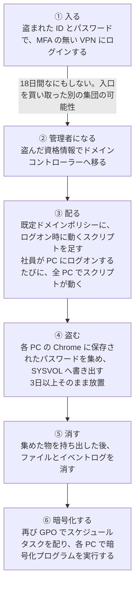
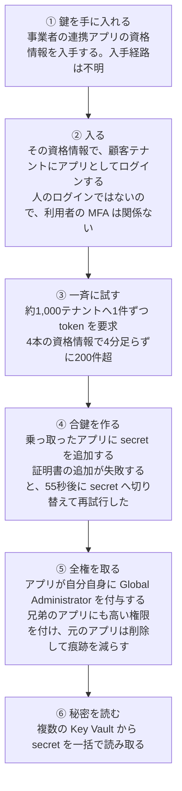
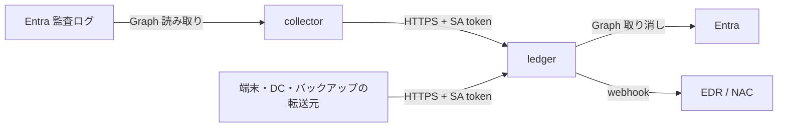

# Qilin / ARTEX 攻撃無効化システム

ランサムウェア集団 **Qilin** と、AI エージェントの攻撃フレームワーク **ARTEX** を使った攻撃（Microsoft が Storm-0940 と呼ぶ活動）を、侵入の各段階で成り立たなくする防御の構想と、その中核部分の実装である。

- 構想: [`idea/`](idea/)（設計判断の正本）
- 実装: [`service/`](service/)（連鎖台帳、方針評価、Entra の監査ログの収集と取り消し）
- 配置: [`deploy/`](deploy/)（Kubernetes と OpenShift。kustomize）
- 試験: [`service/tests/`](service/tests/)（単体）、[`e2e/`](e2e/)（OpenShift 上の E2E と負荷試験）

> 本リポジトリは公開資料にもとづく防御側の研究である。攻撃の説明は、防御を設計するのに必要な粒度に留め、再現手順は書いていない。主体の帰属（Storm-0940 など）は各社の評価をそのまま引いたものである。強制は既定で dry-run であり、本番テナントで使う前に検証環境での実証が要る。

---

## 1. 攻撃者は何をしたか

### 1.1 Qilin（ランサムウェア）

Qilin は 2022年から活動する、ランサムウェアを「サービス」として貸し出す集団である（旧称 Agenda）。Hive Pro は 2026年6月時点で世界で最も活発なランサムウェア活動と評価し、被害組織は1,800を超える。実行するのは加盟者なので、入口の手口は一定ではない。

Sophos が 2024年7月に調査した事案は、手口が一続きで追える。



Hive Pro の 2026年の報告は、これに加えて次の手口を挙げている。

| 段階 | 手口 |
|---|---|
| 入口 | FortiOS、Veeam Cloud Connect、SAP NetWeaver の脆弱性。SAP は修正が出る前に悪用した |
| 横展開 | 暗号化プログラムに PsExec（遠隔実行ツール）を同梱し、集めた資格情報で他の PC に配る |
| 検知の回避 | WSL（Windows 上の Linux）の中で Linux 版を動かし、WSL を見ていない EDR をすり抜ける |
| 暗号化 | Windows、Linux、VMware ESXi（仮想化基盤）のすべて |
| 脅迫 | 暗号化、データ公開の脅迫に、DDoS 攻撃と「弁護士に相談」機能を加えた三重の脅迫 |

**なぜ効くのか。** Qilin は「正規の仕組み」を使う。正しいパスワードで VPN に入り、正規の管理機能である GPO で配る。マルウェアを探す防御は、ログインの時点でも、GPO の変更の時点でも反応しない。Chrome の保存パスワードは、社内だけでなく社外の SaaS の資格情報まで含むので、一度盗まれると組織の側から全部を失効させる手段が無い。

### 1.2 ARTEX と Storm-0940（AI エージェントによる攻撃）

ARTEX は、公開されている複数エージェント型の侵入試験フレームワークである。どの LLM でも動き、偵察からデータ持ち出しまでを人の操作をほとんど介さずに進め、見つけた資産と弱点をグラフに記録する。Microsoft は、中国と連携する Storm-0940 がこれを使ったと評価している（2026-10-21）。

この攻撃の入口は、ある組織そのものではなく、**多数の組織が信頼して入れていたバックアップ事業者（ConnectWise）のクラウド連携アプリ**だった。



並行して、別の拠点から password spray（多数の account に少数のパスワードを試す攻撃）も行われた。

| 期間 | 対象 | 失敗回数 | 最大速度 | 結果 |
|---|---|---|---|---|
| 2026-10-10〜14 | 8組織の327 account | 15.1万件超 | 毎分約2,900件 | 応答の約98%がロックアウト。成功は観測されていない |

標的化から特権の取得まで3時間未満の事例が複数ある（Microsoft）。Huntress は、ツールの改変が実行の合間に素早く行われていることから、人か LLM の操作者がいると見ている。また、速度や User-Agent（通信の名乗り）はツールの改良で消えるので、**何をしたか**を見るべきだと述べている。

**なぜ効くのか。** 連携アプリは、顧客が同意した時点の強い権限を持ったまま、人のログインなしで動く。MFA も、利用者の端末の確認も、この経路には効かない。AI エージェントは失敗を見て数十秒で手口を変えるので、人が警報を見て判断する前に特権まで届く。

### 1.3 二つに共通すること

| 共通点 | Qilin | ARTEX |
|---|---|---|
| 正規の資格情報を使う | 盗んだ VPN のパスワード | 盗んだアプリの資格情報 |
| ディレクトリの変更で権限と配布を得る | GPO の変更 | ロールの付与、secret の追加 |
| 信頼された管理経路を使う | GPO、PsExec | バックアップ事業者の連携アプリ |
| 痕跡を消す | イベントログの消去 | 元のアプリの削除 |
| バックアップが絡む | Veeam の脆弱性が入口 | バックアップ事業者が入口 |

---

## 2. どう防ぐのか

### 2.1 考え方: 追いかけない

「怪しい動きを見つけて止める」設計は、数十秒で手口を変える相手と速さを競うことになる。本構想は次の順で防ぐ。

1. **不変条件で拒否する。** 変更の確定前、ログインの成立前、プログラムの実行前に止める。止める判断が攻撃の速さに左右されない
2. **盗まれても使えなくする。** 資格情報、データ、バックアップを、盗まれる前提で無価値にしておく
3. **それでも残る動きだけを検知して止める。** 連鎖（同じ相手の一連の動き）で判断し、範囲と期限を絞って止める

止める条件は「何をしたか」である。犯人の名前、IP アドレス、User-Agent は記録には残すが、それだけでは止めない。共有回線や正規のツールと重なり、相手が変えれば消えるからである。account の自動ロックもしない。ARTEX の spray で応答の98%がロックアウトだったように、ロックは攻撃者に業務停止を起こさせる道具になる。

### 2.2 七つの層

| 層 | 何を無効化するか | 主な手段 |
|---|---|---|
| L0 露出の縮小 | 脆弱性からの侵入 | 管理画面をインターネットに出さない。悪用が公表された脆弱性を短期間で修正 |
| L1 入口の拒否 | 盗んだパスワードでのログイン | phishing-resistant MFA と管理端末の証明書が揃わなければ token を出さない |
| L2 管理基盤の不変条件 | ディレクトリの変更による特権と配布 | 連携アプリへの secret 追加を確定前に拒否。強い権限を誰にも常時持たせない |
| L3 資格情報の無価値化 | 盗んだ資格情報の再利用 | ブラウザーへのパスワード保存を禁止。アプリの長期 secret を廃止 |
| L4 実行と横展開の拒否 | 配られたプログラムの実行 | 署名済みの App Control 方針で許可したものだけを実行。端末どうしの遠隔実行を拒否 |
| L5 データの無価値化 | 持ち出しと公開の脅迫 | サーバーの外向き通信を既定で拒否。ファイル自体を暗号化 |
| L6 回復の保証 | 暗号化と破壊 | バックアップを本番とは別の ID で管理し、削除は二人の承認なしに確定しない |

各層は「前の層が破られた」前提で作る。設計の詳細は [`idea/defense-system.md`](idea/defense-system.md)、各手段が製品の機能で本当に成り立つかの調査は [`idea/precommit-feasibility.md`](idea/precommit-feasibility.md) にある。

### 2.3 攻撃の各段階をどう止めるか

| 攻撃の段階 | 止め方 | 担うもの | 残る穴 |
|---|---|---|---|
| Qilin ① VPN にパスワードで入る | MFA と端末証明書が無ければ token を出さない | IdP の Conditional Access／**本実装 P1** | phishing-resistant MFA の要素そのものの窃取 |
| Qilin ① 脆弱性で入る | 管理画面を隠し、短期で修正する | 運用（L0） | 修正前の悪用 |
| Qilin ② DC へ移る | Domain Admins を常時持たせず、管理端末からしか使えなくする | AD の認証ポリシーのサイロ | 管理端末そのものの乗っ取り |
| Qilin ③ GPO にスクリプトを足す | 変更は止められない。署名の無いスクリプトを端末で動かさない。変更を検出する | App Control／**本実装 Q8** | 許可済みのツールの悪用 |
| Qilin ④ Chrome のパスワードを盗む | ブラウザー保存を禁止。盗まれても MFA で使わせない | 端末の方針／L1 | パスワードだけで入れる社外サイト |
| Qilin ⑤ ログを消す | 停止は拒否できない。記録を即時に外へ送り、消せない保存先に置く。途絶を検出する | 不変ストレージ／**本実装 Q2、I5b** | 送る前に消された記録 |
| Qilin PsExec で横展開 | 端末どうしの遠隔実行を拒否。複数端末で拒否が続けば、その端末を隔離し権限を取り消す | ホスト FW／**本実装 Q1** | 許可済みの管理ツールの悪用 |
| Qilin ⑥ 暗号化 | 実行させない。暗号化されても戻せる | App Control／L6 | 仮想化基盤の管理面の乗っ取り |
| Qilin データ公開の脅迫 | 外へ出さない。出てもファイルを開けなくする | 外向き FW、ファイル暗号化 | 暗号化対象外のデータ |
| ARTEX ① 連携アプリの鍵 | 長期 secret を使わない | アプリ設計（L3） | 事業者側での証明書の窃取 |
| ARTEX ③ 一斉に試す | 同意時点の権限の上限を絞る。登録範囲外の操作は止めて案件にする | **本実装 P8** | 登録範囲内の読み取り |
| ARTEX ④ secret を足す | 確定前に拒否。すり抜けた分は即時に無効化 | Entra の app management policy／**本実装 P4** | 除外属性や方針の変更権限を奪われた場合 |
| ARTEX ⑤ 自分に全権を付与 | その権限を外部のアプリに持たせない。すり抜けた付与は即時に取り消す | 権限の棚卸し／**本実装 P4** | 権限の設定漏れ（その場合は事後の取り消し） |
| ARTEX ⑥ Key Vault の一括読み取り | 読める主体を絞る。登録外の一括読み取りを案件にする | Key Vault の権限／**本実装 Q5** | 登録範囲内の読み取り |
| ARTEX password spray | 連鎖ごとに速度制限。正規の利用者は追加認証で通す。ロックはしない | **本実装 P2** | 低速で分散した spray |
| PIM を通さない全権の付与 | 拒否できない。検出して取り消す | PIM のアラート／**本実装 Q7** | 検出までの時間 |
| バックアップの削除 | 別テナントの承認者なしに確定しない | Azure Backup の Resource Guard、Veeam の four-eyes／**本実装 Q4** | バックアップサーバー自体の乗っ取り |

「残る穴」は、この構想で塞いでいない部分である。塞いだとは書かない。

---

## 3. このソフトウェアがすること

構想のうち、**連鎖を記録し、方針で判定し、すり抜けた変更を機械の速さで取り消す部分**を実装した。Entra の Conditional Access、app management policy、App Control、Resource Guard などの製品設定は、このソフトウェアの外にある。

### 3.1 構成



| 部品 | 種類 | 責務 | Entra での権限 |
|---|---|---|---|
| `defence-ledger` | StatefulSet（1台、PV） | 事象の受け取り、連鎖台帳、方針評価、取り消しの実行、案件、発生源の途絶検出 | 強制用アプリ。資格情報とロール割り当ての取り消し |
| `defence-collector` | Deployment | Entra 監査ログの取り込みと事象への変換 | 収集用アプリ。監査ログの読み取りだけ |
| `defence_client`（[`client/`](client/)） | Python ライブラリ | アプリから事象を送り、判定を受け取る。再送、台帳の障害時の fail-open/closed、生存通知 | なし |

### 3.2 方針

| 規則 | 条件 | 応答 |
|---|---|---|
| P1 | 証明書と phishing-resistant MFA の無い対話認証 | token を出さない。account の状態は変えない |
| P4 | アプリ（service principal）による資格情報、所有者、ロール、同意の変更 | secret とロールは自動で取り消す。所有者と同意は人への提案。案件を開く |
| P3 | おとりの URL への接触から30分以内の、証明書の無い本番認証 | その連鎖を60分遮断 |
| P2 | 5分で10 account 以上への認証失敗 | 証明書の無い連鎖を速度制限。ロックアウトが半数を超えたら account ロックを抑止 |
| P8 / A2 | 登録範囲の外／内のアプリ操作 | 提案と案件／許可 |
| P7 | 登録済みのクローラーや診断の、おとりへの接触 | 記録のみ |
| A1 | MFA と端末証明書が揃った対話認証 | 許可 |
| P5 / P6 | 期限付きの IOC の IP／User-Agent との一致 | 記録のみ（単独では止めない） |
| Q1 | 10分で3端末以上での実行・横展開の拒否 | 端末どうしの通信を隔離し、時間限定の権限を取り消す |
| Q2 | 監査の停止や消去 | 記録と案件（拒否はできない） |
| Q3 | おとりファイルへの書き込み | 端末どうしの通信を隔離 |
| Q4 | 承認の無いバックアップ変更 | 記録。通ってしまった場合は提案 |
| Q5 | 登録外の主体による secret の一括読み取り | 提案と案件 |
| Q6 | 拒否を受けた連鎖からの外向き通信 | 遮断を延長 |
| Q7 | PIM を通さない高権限ロールの付与 | 取り消しの提案と案件 |
| Q8 | GPO や SYSVOL の変更の確定 | 案件（事後検出） |
| I5b | 登録した発生源からの事象の途絶 | 案件 |

評価順は [`idea/admission-control.md`](idea/admission-control.md) 節6に従い、先に一致した規則が応答になる。P3 と P2 の遮断は、P1 が先に一致しても台帳に残す。P1 で拒否した後も、同じ連鎖の次の試行を止めるためである。

### 3.3 設計上の判断

- 閾値と IOC は [`deploy/base/policy.yaml`](deploy/base/policy.yaml)（ConfigMap）に置き、コードに書かない。IOC は期限付きで書く
- Entra への認証は workload identity federation だけを使う。Pod に投影した ServiceAccount token をそのまま Entra に渡し、長期の client secret は置かない
- 台帳への呼び出しは、audience `defence-ledger` の投影 token を Kubernetes の TokenReview で検証する。共有鍵は置かない
- 強制は `dry-run` が既定。`enforce` でも、`automatic_kinds` に無い種類は提案に留める
- アプリや service principal を削除する処理、account をロックする処理は持たない。証明書の取り消しは所有の証明が要るので人へ回す

### 3.4 強制用アプリの扱い

強制用アプリは、取り消しのために `Application.ReadWrite.All` と `RoleManagement.ReadWrite.Directory` 相当の権限を要る。これは構想が外部のアプリに禁じた権限そのものであり、**このアプリ自体が最重要（Tier 0）の資産になる**。

- 自テナントの台帳に用途を明記して登録する
- 収集用とは別のアプリにする。収集用は `AuditLog.Read.All` だけ
- federated credential の subject は `system:serviceaccount:defence-system:defence-ledger` に限る
- 名前空間 `defence-system` を操作できる人を、Tier 0 の担当に限る
- 取り消しに要る最小の権限は、検証テナントで確かめる ※要確認

---

## 4. 配置

| 項目 | Kubernetes | OpenShift |
|---|---|---|
| TLS | cert-manager | service-ca（標準機能） |
| Pod の権限 | Pod Security `restricted` | SCC `restricted-v2`。runAsUser は指定しない |
| 外向き通信の宛先制限 | CNI の機能で別途 | [`overlays/openshift/egress`](deploy/overlays/openshift/egress/)（EgressFirewall、任意） |
| Entra の federated credential | ServiceAccount 発行者の OIDC 探索文書が、インターネットから読めること | 同左 |

1. Entra にアプリを二つ登録し（強制用と収集用）、それぞれに federated credential を作る
   - issuer: クラスターの ServiceAccount 発行者 URL
   - subject: `system:serviceaccount:defence-system:defence-ledger` と `...:defence-collector`
   - audience: `api://AzureADTokenExchange`
2. [`deploy/base/kustomization.yaml`](deploy/base/kustomization.yaml) の `defence-entra` に、テナント ID と二つの client ID を書く
3. イメージをビルドしてレジストリに置き、`images` を合わせる

```bash
podman build -t quay.io/example/defence-ledger:0.1.0 -f service/Containerfile service
```

4. 適用する

```bash
oc apply -k deploy/overlays/openshift
```

```bash
kubectl apply -k deploy/overlays/kubernetes
```

5. 端末やバックアップの転送元の名前空間にラベル `defence.example/event-source=true` を付け、その ServiceAccount を `ALLOWED_CALLERS` に足す。アプリへの組み込みは [docs/integration.md](docs/integration.md)
6. 検証テナントで E2E を通した後に、`policy.yaml` の `enforcement.mode` を `enforce` にする

### API

| メソッド | パス | 内容 |
|---|---|---|
| POST | `/v1/events` | 事象（1件または配列）。判定と強制の結果を返す |
| GET | `/v1/cases` | 開いている案件 |
| GET | `/v1/actions` | 取り消しと提案の記録 |
| GET / PUT | `/v1/cursors/{name}` | 収集の取り込み位置 |
| GET | `/healthz`, `/readyz` | プローブ |

事象のスキーマは [`service/src/defence/models.py`](service/src/defence/models.py) にある。

---

## 5. 試験

### 5.1 単体テスト

```bash
cd service && uv venv --python 3.12 .venv && uv pip install --python .venv -e '.[test]' pytest-cov && .venv/bin/python -m pytest -q --cov=defence --cov-branch
```

結果: 78件すべて合格。分岐を含む網羅率 98%（2026-10-28）。

構想の失敗パターン F1〜F12（入口）と G5、G6、G10、G11、G15、G16（侵入後）を、判定として一つずつ確かめる。並行に同じ事象が届いても案件が重複しないこと、取り込みを重ねても取り消しが一回だけであることも含む。

クライアント（`client/`）は、台帳の環境に入れて同じように動かす。台帳の本物と組み合わせた試験（P1 での拒否、障害中に溜めた事象を送り直しても一件として扱われること）も含む。

```bash
uv pip install --python service/.venv -e client && cd client && ../service/.venv/bin/python -m pytest -q
```

結果: 30件すべて合格。分岐を含む網羅率 98%（2026-10-28）。

### 5.2 E2E（OpenShift）

```bash
service/.venv/bin/python e2e/run_e2e.py
```

本番と同じマニフェストを専用の名前空間に展開し、Entra、Graph、EDR の webhook だけを模擬サーバー（[`e2e/mock_entra.py`](e2e/mock_entra.py)）に置き換える。模擬サーバーは、ARTEX 事例を模した監査記録（自分への secret 追加、自分と兄弟への全権付与）を返す。

| シナリオ | 確かめたこと | 結果 |
|---|---|---|
| S1 ARTEX | 収集が監査ログを読み、台帳が攻撃者の secret と、自分・兄弟への GA 付与を取り消す。正規の secret と人の GA は残す。アプリを削除しない。Entra への認証は投影 token だけ | 合格 |
| S2 重複 | 監査ログを何度読み直しても、取り消しと案件は一回だけ | 合格 |
| S3 Qilin | VPN（P1）、spray（P2、正規利用者は通過）、おとり（P3）、GPO（Q8）、監査停止（Q2）、横展開（Q1、EDR へ隔離を通知）、おとりファイル（Q3）、外向き（Q6）、バックアップ（Q4）。account のロックは出さない | 合格 |
| S4 認証と通信 | token なし 401、登録外の ServiceAccount 403、登録外の Pod は NetworkPolicy で届かない | 合格 |
| S5 永続性 | 台帳 Pod を消しても、案件と P3 の遮断が残る | 合格 |
| S6 途絶 | 黙った発生源に案件が開く。動いている収集は途絶扱いにならない | 合格 |
| S7 実行権限 | SCC `restricted-v2`、任意 UID で動く | 合格 |
| S8 負荷 | クラスター内から 5,000件を並行送信。取りこぼし0、再起動0 | 合格 |

実施: OpenShift 4.21（単一ノード、OVN-Kubernetes）、2026-10-28。33項目すべて合格。

### 5.3 負荷試験

```bash
service/.venv/bin/python e2e/stress.py --url https://<ledger> --ca <ca.crt> --events 10000 --concurrency 32
```

認証 70%、アプリ操作 10%、端末の拒否 10%、P4（アプリによる全権付与）10% を混ぜて並行に送る。合格条件は、エラー0、P4 の全件が案件になること、p99 が2秒以内、ARTEX の spray の最大速度（毎分2,900件）を上回ること。

| 実施場所 | 件数 | 並行数 | エラー | 処理量 | p50 | p99 | P4 の案件化 |
|---|---|---|---|---|---|---|---|
| ローカル（HTTP、認証なし） | 10,000 | 32 | 0 | 毎分 22,658件 | 35 ms | 518 ms | 958 / 958 |
| OpenShift 内（HTTPS、TokenReview） | 5,000 | 32 | 0 | 毎分 9,580件 | 193 ms | 358 ms | 460 / 460 |

どちらも ARTEX の spray の最大速度（毎分約2,900件）を3倍以上上回る。評価は一件ずつ直列に行う設計なので（窓の集計と記録の間に別の事象を割り込ませないため）、処理量の上限は1台の台帳の速さで決まる。

---

## 6. 限界と未実証

- 本物の Entra テナントには接続していない。監査ログの活動名と項目の形は、文書と公開事例からの推定である。PIM 経由の割り当てを `MS-PIM` で見分ける点を含め、実テナントで確かめる ※要確認
- 台帳は SQLite の1台構成である。台帳が止まる間、事象は送り手が再送する前提である。冗長化には外部のデータベースが要る
- P1 の強制点は IdP と VPN ゲートである。この実装は判定を返すが、VPN ゲートとの接続は製品ごとに作る
- 監査ログの到着遅延の間は、P4 の取り消しが遅れる。60秒以内の目標は、実テナントの遅延を含めては測っていない
- NetworkPolicy がプローブを止める CNI では、ノードの CIDR を足す
- `Containerfile` のベースイメージはタグ指定である。本番ではダイジェストで固定する

## 7. 出典

- Sophos X-Ops. "Qilin ransomware caught stealing credentials stored in Google Chrome"（2024年7月の観測）. https://www.sophos.com/en-us/blog/qilin-ransomware-caught-stealing-credentials-stored-in-google-chrome
- Hive Pro. "Qilin Rising: Continued Global Dominance and Expanded Tradecraft"（TA2026155, 2026-06-04）. https://www.hivepro.com/threat-advisory/qilin-rising-continued-global-dominance-and-expanded-tradecraft
- Microsoft Security Blog. "AI-driven, large-scale nation-state campaign using ARTEX enables supply chain compromise"（2026-10-21）. https://www.microsoft.com/en-us/security/blog/2026/10/21/storm-0940-uses-artex-agentic-ai-connectwise-supply-chain-compromise/
- Huntress. "AI, Scripts, Operator: Inside the ConnectWise Attack"（2026-10-26）. https://www.huntress.com/blog/connectwise-attack-ai
- 製品の機能の出典は [`idea/precommit-feasibility.md`](idea/precommit-feasibility.md) 節7にまとめた
